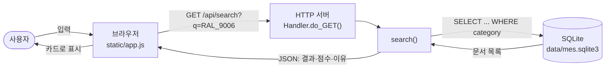
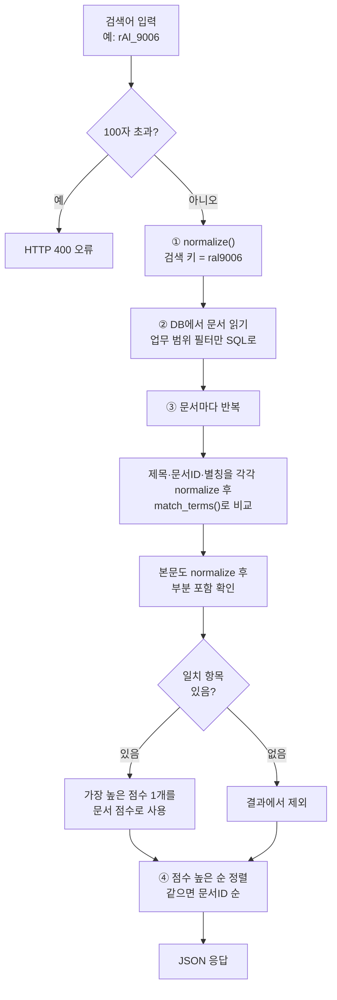
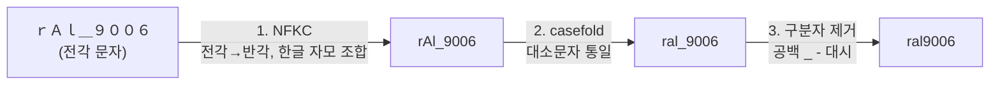
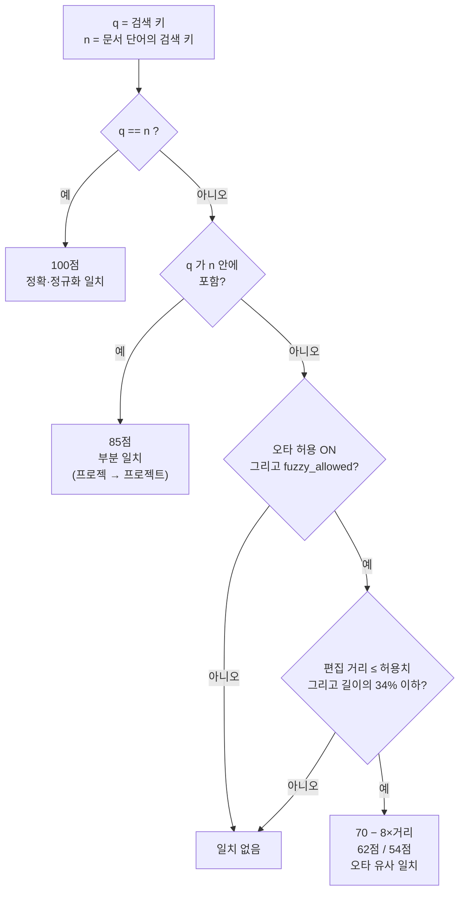
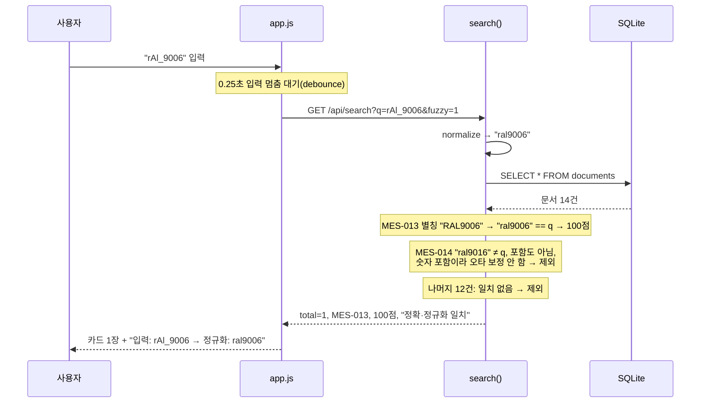

# 검색은 어떻게 동작하나

이 문서는 MES 검색 실험실이 **검색어 하나를 받아 결과를 돌려주기까지** 무슨 일이 일어나는지 설명합니다.
코드는 `app.py` 한 파일(약 240줄)에 모두 있으며, 각 단계마다 주석이 달려 있습니다.

> 그림(Mermaid)은 GitHub 또는 VS Code의 Markdown 미리보기(Mermaid 확장)에서 도식으로 보입니다.

---

## 1. 한 장 요약

핵심 아이디어는 단 하나입니다.

> **검색어와 문서의 단어를 똑같은 규칙으로 "검색 키"로 바꾼 뒤, 검색 키끼리 비교한다.**

사람마다 `RAL9006`, `RAL_9006`, `ral-9006`, `rAl 9006`처럼 다르게 입력해도
검색 키는 모두 `ral9006` 하나가 되므로 같은 문서를 찾습니다.
이 규칙은 특정 코드 전용이 아니라 **모든 검색어와 모든 문서 필드(제목, 문서ID, 별칭, 본문)에 똑같이 적용**됩니다.

| 사용자 입력 | 검색 키 | 찾는 문서 |
|---|---|---|
| `RAL_9006`, `ral-9006`, `rAl 9006`, `ＲＡＬ－９００６` | `ral9006` | MES-013 컬러강판 도장 색상 RAL9006 |
| `mes_001`, `Mes 001`, `MES-001` | `mes001` | MES-001 |
| `COLD_ROLLING`, `cold-rolling`, `ColdRolling` | `coldrolling` | MES-002 (별칭 cold rolling) |
| `작업_지시`, `작업-지시`, `작업 지시` | `작업지시` | MES-002 |
| `SP-CC`, `s_p_c_c` | `spcc` | MES-012 |

---

## 2. 전체 구조



| 파일 | 역할 |
|---|---|
| `app.py` | 서버, DB 초기화, **검색 로직 전부** |
| `static/app.js` | 입력을 서버로 보내고 결과 카드를 그림 (검색 로직 없음) |
| `static/index.html`, `style.css` | 화면 |
| `tests/test_search.py` | 검색 규칙 테스트 (`python -m unittest discover -s tests -v`) |

---

## 3. 검색 한 번의 흐름



---

## 4. ① 정규화: 검색 키 만들기 (`normalize`)



| 단계 | 처리 | 해결되는 입력 예 |
|---|---|---|
| 1. NFKC | 전각 → 반각, 분해된 한글 → 조합형 | `ＣＯＩＬ`, `ＲＡＬ－９００６`, 맥에서 복사한 한글 |
| 2. casefold | 대문자 → 소문자 | `Project`, `PROJECT`, `rAl` |
| 3. 구분자 제거 | 공백·탭, `_`, `-`, 워드/엑셀이 바꾼 대시 `– — ‐ −` | `프 로 젝 트`, `RAL_9006`, `cold-rolling` |

**일부러 지우지 않는 문자**

| 문자 | 지우지 않는 이유 |
|---|---|
| `.` | 두께 `1.2`와 `12`가 같은 값이 되면 안 됨 |
| `/` | `폭/두께`처럼 의미 있는 구분에 쓰임 |
| `%` `'` `=` 등 | 지우면 `%` 같은 검색어가 빈 값이 되어 전체 문서가 나옴 |

구분자를 추가하거나 빼고 싶으면 `app.py`의 `SEPARATORS` 정규식 한 줄만 고치면 됩니다.

**주의할 점:** 공백과 구분자를 지우면 서로 다른 단어가 붙을 수 있습니다. 예를 들어 `A-1 2`와 `A-12`는 같은 검색 키가 됩니다.
운영 시스템에서는 코일번호·주문번호처럼 정확해야 하는 값은 별도 코드 컬럼으로 분리해서 관리하는 것을 권장합니다.

---

## 5. ③ 비교 규칙과 점수 (`match_terms`)

검색 키 `q`와 문서 단어의 검색 키 `n`을 아래 순서로 비교합니다. 위에서 맞으면 아래는 보지 않습니다.



별도로, **본문**에 검색 키가 포함되면 **75점**(본문 부분 일치)입니다.
한 문서에서 여러 단어가 맞으면 **가장 높은 점수 하나**가 그 문서의 점수입니다.

| 점수 | 이유 | 예 |
|---|---|---|
| 100 | 정확·정규화 일치 | `ral_9006` → 별칭 `RAL9006` |
| 85 | 부분 일치 | `9006` → `RAL9006`, `프로젝` → `프로젝트` |
| 75 | 본문 부분 일치 | `목표_두께` → 본문 "…목표 두께 관리" |
| 62 / 54 | 오타 유사 일치 (편집 1회 / 2회) | `후로젝트` → `프로젝트` |

점수는 순위를 정하기 위한 규칙 값이며 확률이 아닙니다.

### 오타 보정(편집 거리) 원리

편집 거리(Levenshtein)는 한 단어를 다른 단어로 바꾸는 데 필요한 **최소 글자 삽입·삭제·교체 횟수**입니다.

```
후 로 젝 트
↓ (교체 1회)
프 로 젝 트      → 거리 1 → 70 − 8 = 62점
```

**오타 보정을 하지 않는 경우** (`fuzzy_allowed`)

| 조건 | 이유 |
|---|---|
| 숫자가 섞인 값 (`RAL9006`, `MES-001`) | `RAL9007`은 오타가 아니라 **다른 색**. 섞이면 오검색 |
| 강종 코드 `SPCC`, `SPCD` | `SPCE`가 `SPCC`로 바뀌면 안 됨 |
| 3자 미만, 30자 초과 | 짧으면 아무 단어나 걸리고, 길면 계산 비용이 큼 |
| 길이 차이 3자 이상 | 허용 거리(최대 2)를 넘으므로 계산 생략 |

그래서 `RAL_9006`은 **구분자 제거로** 찾고, `RAL9007`은 **찾지 않습니다**. 테스트(`test_code_no_false_positive`)로 확인합니다.

---

## 6. 예시 추적: `rAl_9006`을 검색하면



화면의 회색 안내 줄(`입력 → 정규화`)에서 서버가 실제로 어떤 검색 키로 비교했는지 바로 확인할 수 있습니다.

---

## 7. 새 업무 용어를 찾게 하려면

검색 규칙은 바꿀 필요가 없습니다. **문서의 별칭(aliases)에 단어를 추가**하면 됩니다.

- 표기 차이(대소문자, 공백, `_`, `-`, 전각)는 자동 처리되므로 별칭은 **한 가지 표기로만** 등록하면 됩니다.
  예: `RAL9006`만 등록하면 `ral_9006`, `RAL-9006`도 찾음.
- 뜻이 같은 다른 단어(한↔영, 약어)는 자동 번역이 아니므로 직접 등록해야 합니다.
  예: `화이트 알루미늄`, `white aluminium`.

샘플 수정 방법은 README의 "데이터 변경과 API"를 참고하세요.

---

## 8. 함수 찾아보기 (`app.py`)

| 함수/상수 | 하는 일 |
|---|---|
| `SEED` | 샘플 문서 14건 |
| `SEPARATORS` | 지울 구분자 정규식 |
| `normalize(text)` | 검색 키 생성 (NFKC → casefold → 구분자 제거) |
| `distance(a, b)` | 편집 거리 계산 |
| `fuzzy_allowed(q, n, term)` | 오타 보정을 해도 안전한지 판단 |
| `match_terms(q, terms, fuzzy)` | 단어 목록과 비교해 점수 목록 반환 |
| `search(query, category, fuzzy)` | 검색 본체: 읽기 → 비교 → 정렬 → 응답 |
| `init_db()` | 테이블 생성, 샘플 삽입 (기존 데이터 유지) |
| `Handler` | `/api/search`와 정적 파일 3개만 제공, 그 외 404 |
